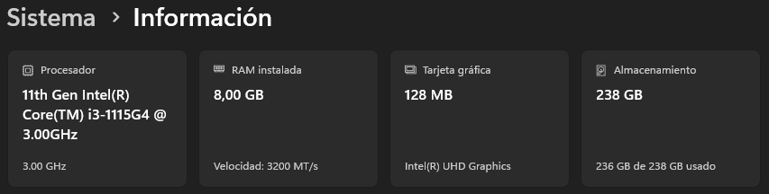

# 🤖 Semillero de Inteligencia Artificial

<p align="center">
   
   
   
   
</p>

🔗 **LinkedIn:** [@scedison](https://www.linkedin.com/in/scedison/)

## 📖 Acerca del proyecto

El **Semillero de Inteligencia Artificial** es un espacio dedicado al *aprendizaje práctico* en el campo de los **modelos de lenguaje** y los **LLMs**.

## 💻 Características de mi laptop

<p align="center">
  
</p>

## 🧭 Cómo usar este semillero

1. Clona el repositorio:

   ```bash
   git clone https://github.com/Semillero-Inteligencia-Artificial/talleres.git
   cd talleres
   ```

2. Navega al taller de tu interés:

   ```bash
   cd taller-1
   ```

3. Lee el `README.md` del taller y sigue los pasos.
4. Ejecuta las celdas del notebook con **Jupyter Lab**.

## 🏫 Talleres

| N° | Taller | Estado | Práctica | README |
|----|--------|:------:|----------|--------|
| 1 | Enseñando a la IA a contar chistes | ✅ Completado | Enseñar a un Transformer a generar chistes | [Ver README](taller-1/README.md) |
| 2 | Expedición Lunar — Cartas desde la Luna con LLMs | ✅ Completado | Dominar parámetros de un LLM (Ollama + gemma2:2b) | [Ver README](taller-2/README.md) |
