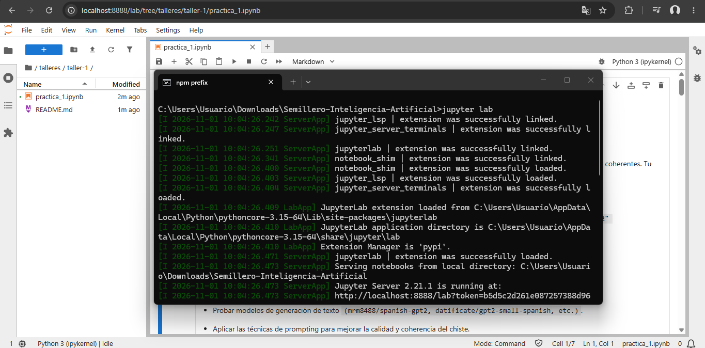
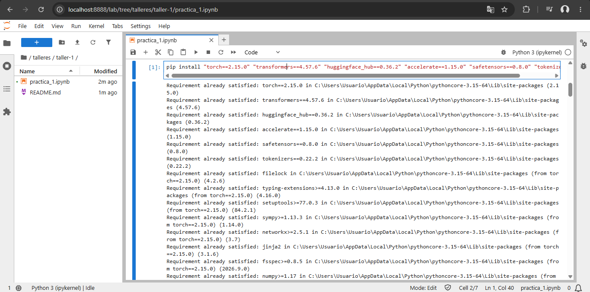
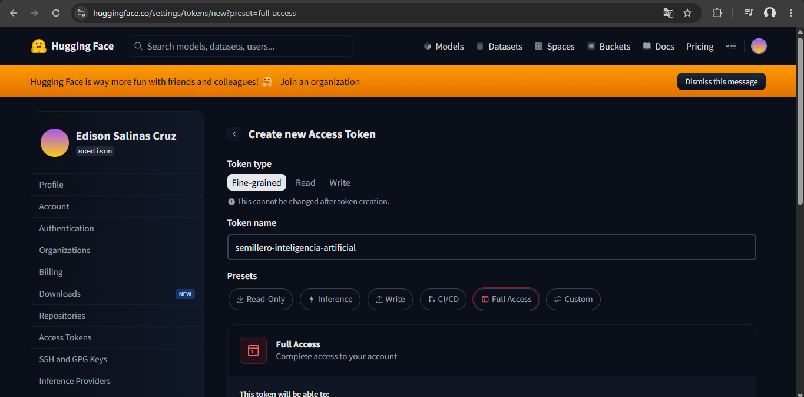
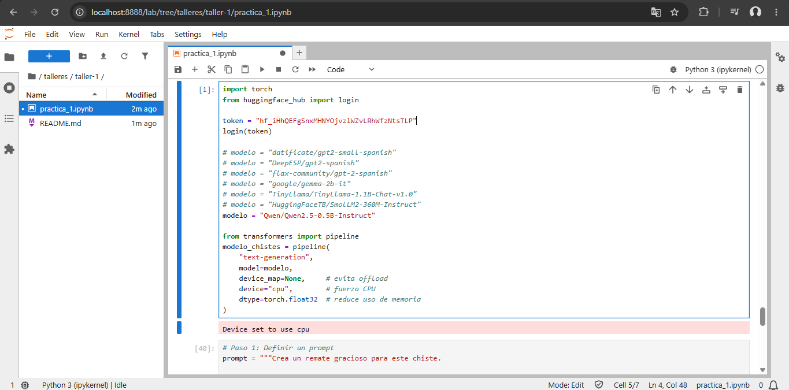
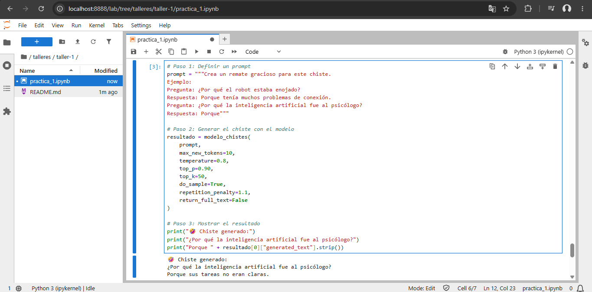

# 🎭 Taller 1: Enseñando a la IA a contar chistes

<p align="center">
  
  
  
</p>

> 🎭 *Los modelos de lenguaje entienden texto, pero… ¿entienden el humor? 😅*

## 🎯 Descripción

En esta práctica se enseña a un Transformer de Hugging Face a generar chistes divertidos y coherentes, probando modelos y técnicas de prompting para obtener el mejor chiste posible.

## 📋 Requisitos

### 📦 Librerías

Ejecutar el siguiente comando:

```bash
pip install "torch>=2.3.0" "transformers==4.44.2" "huggingface_hub==0.25.2" "accelerate==0.33.0" "safetensors==0.4.4"
pip install hf_xet
```

### 🔑 Cuenta y credenciales

Crear una cuenta en Hugging Face y generar un token de acceso.

## 🚀 Pasos de la práctica

### Paso 1: Levantar Jupyter Lab

Abrir la terminal (cmd) y ejecutar:

```bash
jupyter lab
```

Esto abrirá la interfaz en el navegador en `http://localhost:8888`.



### Paso 2: Instalar las librerías

Ejecutar el comando de instalación:

```bash
pip install "torch>=2.3.0" "transformers==4.44.2" "huggingface_hub==0.25.2" "accelerate==0.33.0" "safetensors==0.4.4"
```



### Paso 3: Crear el token y hacer login

Crear el token en Hugging Face:



Ejecutar el código de login:

```python
from huggingface_hub import login

token = "hf_XXXXXXXXXXXXXXXXXXXXXXXXXXXX"
login(token)
```

### Paso 4: Cargar el modelo

Ejecutar el código de carga:

```python
from transformers import pipeline

modelo_chistes = pipeline(
    "text-generation",
    model=modelo,
    device_map=None,     # evita offload
    device="cpu",        # fuerza CPU
    dtype=torch.float32  # reduce uso de memoria
)
```



### Paso 5: Definir el prompt

Ejecutar el código del prompt:

```python
prompt = """Crea un remate gracioso para este chiste.
Ejemplo:
Pregunta: ¿Por qué el robot estaba enojado?
Respuesta: Porque tenía muchos problemas de conexión.
Pregunta: ¿Por qué la inteligencia artificial fue al psicólogo?
Respuesta:"""
```

### Paso 6: Generar el chiste

Ejecutar el código de generación:

```python
resultado = modelo_chistes(
    prompt,
    max_new_tokens=10,
    temperature=0.8,
    top_p=0.90,
    top_k=50,
    do_sample=True,
    repetition_penalty=1.1,
    return_full_text=False
)

print("🤣 Chiste generado:")
print("¿Por qué la inteligencia artificial fue al psicólogo?")
print("Porque " + resultado[0]["generated_text"].strip())
```



## 📊 Resultado

> 🤣 **Chiste generado:**
>
> ¿Por qué la inteligencia artificial fue al psicólogo?
> **Porque sus tareas no eran claras.**

### Parámetros utilizados

<table align="center">
  <thead>
    <tr>
      <th>Parámetro</th>
      <th>Valor</th>
    </tr>
  </thead>
  <tbody>
    <tr><td><code>max_new_tokens</code></td><td>10</td></tr>
    <tr><td><code>temperature</code></td><td>0.8</td></tr>
    <tr><td><code>top_p</code></td><td>0.90</td></tr>
    <tr><td><code>top_k</code></td><td>50</td></tr>
    <tr><td><code>do_sample</code></td><td>True</td></tr>
    <tr><td><code>repetition_penalty</code></td><td>1.1</td></tr>
    <tr><td><code>return_full_text</code></td><td>False</td></tr>
  </tbody>
</table>

## 🧠 Lo que aprendí

<details>
<summary>💬 Prompting y generación</summary>

- **Ejemplos en el prompt:** mejora la coherencia del chiste.
- **Parámetros:** `temperature`, `top_p` y `max_new_tokens` controlan creatividad y coherencia.
- **Pipeline:** `transformers.pipeline` simplifica la generación de texto.

</details>

<details>
<summary>💻 Hardware</summary>

- **Laptop limitada:** 8 GB RAM, CPU i3 y gráficos integrados; modelos grandes no son viables.
- **Modelo adecuado:** `Qwen/Qwen2.5-0.5B-Instruct` funciona bien en CPU.
- **Prompt simplificado:** respuestas más directas por lentitud en el equipo.

</details>

<details>
<summary>🔑 Hugging Face</summary>

- Crear cuenta y generar token de acceso.
- Ejecutar `login(token)` para usar modelos con restricciones.

</details>
