# 🌙 Taller 2: Expedición Lunar — Cartas desde la Luna con LLMs

<p align="center">
  
  
  
  
</p>

> 🌙 *En el año 2042, los astronautas de la Base Selene escriben cartas a la Tierra usando un modelo de lenguaje. Cada parámetro cambia el tono: frío y preciso, o cálido y creativo.*

## 🎯 Descripción

En esta práctica se enseña a dominar los parámetros de un modelo de lenguaje usando Ollama y el modelo gemma2:2b para generar cartas lunares con distintos tonos y estilos.

## 📋 Requisitos

### 📦 Librerías

Instalar la librería de Ollama para Python desde una celda de Jupyter:

```bash
pip install ollama
```

### 🖥️ Instalación de Ollama y modelo

Tener Ollama instalado y corriendo (`ollama serve` en una terminal).
El modelo se instala al ejecutar `ollama run gemma2:2b` en el Paso 3.

## 🚀 Pasos de la práctica

### Paso 1: Instalar Ollama

Ejecutar el instalador de Ollama en Windows.

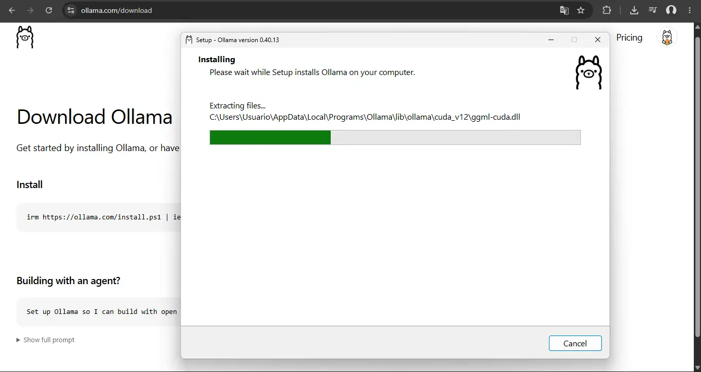

### Paso 2: Aplicación de escritorio de Ollama

Abrir la aplicación de escritorio de Ollama.

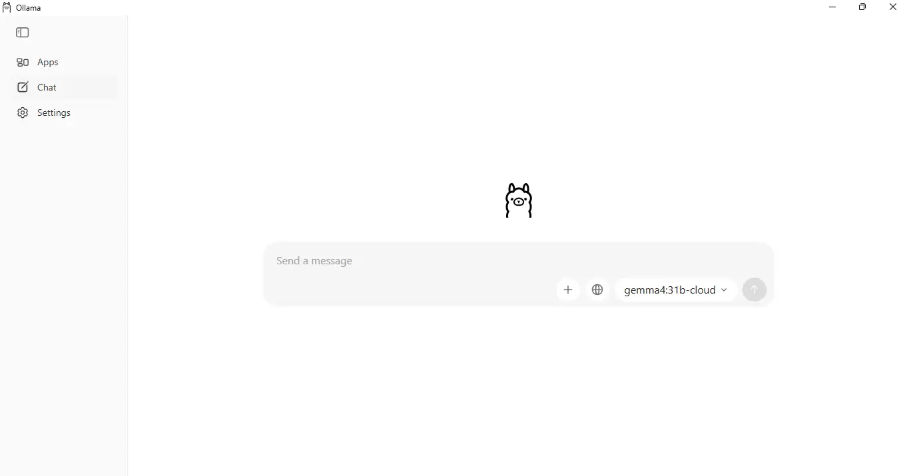

### Paso 3: Ejecutar el comando ollama run

Descargar e iniciar el modelo gemma2:2b.

```bash
ollama run gemma2:2b
```

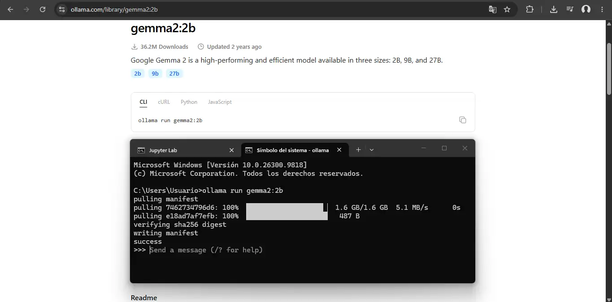

### Paso 4: Enviar mensaje de prueba

Enviar un mensaje al modelo preguntando: ¿Cuál es la capital del país Ecuador?

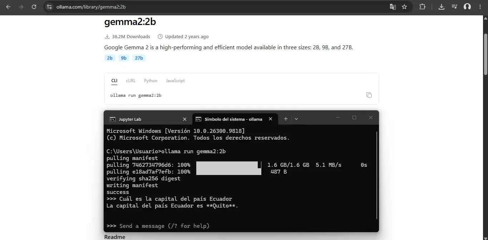

### Paso 5: Instalar la librería de Ollama en Python

Instalar la librería de Ollama para Python desde una celda de Jupyter:

```bash
pip install ollama
```

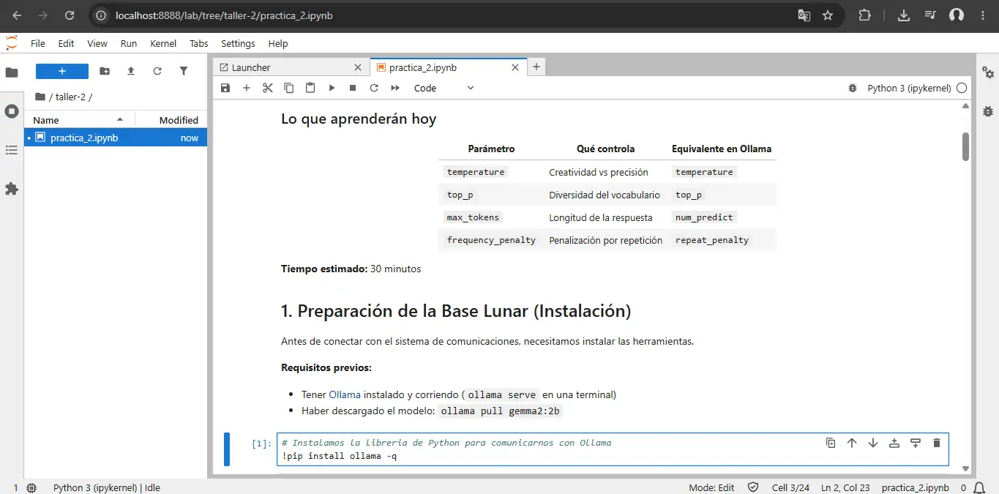

### Paso 6: Conectar con Ollama desde Jupyter

Conectar con Ollama desde una celda de Jupyter definiendo la función `generar_carta` que permite enviar prompts y recibir respuestas del modelo:

```python
import ollama

def generar_carta(prompt, opciones=None, modelo="gemma2:2b"):
    """
    Genera texto usando Ollama con las opciones especificadas.

    Args:
        prompt: El texto de instruccion para el modelo.
        opciones: Diccionario con parametros (temperature, top_p, num_predict, repeat_penalty).
        modelo: Nombre del modelo a usar.
    """
    respuesta = ollama.generate(
        model=modelo,
        prompt=prompt,
        options=opciones or {},
        think=False  # Desactiva el razonamiento interno (thinking tokens) que consume num_predict
    )
    print("=" * 60)
    print(f"Parametros usados: {opciones or 'default'}")
    print("=" * 60)
    print(respuesta["response"])
    print(f"\n[Tokens generados: {respuesta.get('eval_count', 'N/A')}]")
    return respuesta["response"]

print("Conexion con Ollama establecida.")
```

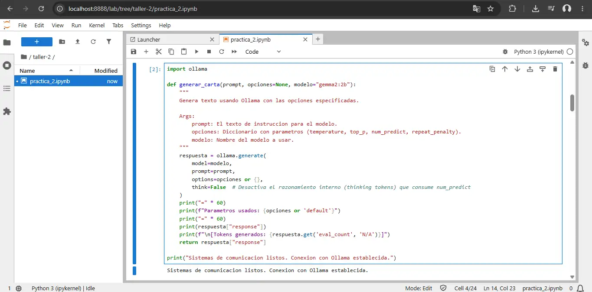

### Paso 7: Cargar el modelo gemma2:2b

Cargar el modelo gemma2:2b y verificar que la conexión funcione enviando un mensaje de prueba:

```python
# Prueba basica de conexion
respuesta = ollama.generate(
    model="gemma2:2b",
    prompt="Como regla solo debes decir: 'Conexion establecida desde la Base Selene' y nada mas.",
    think=False
)
print(respuesta["response"])
```

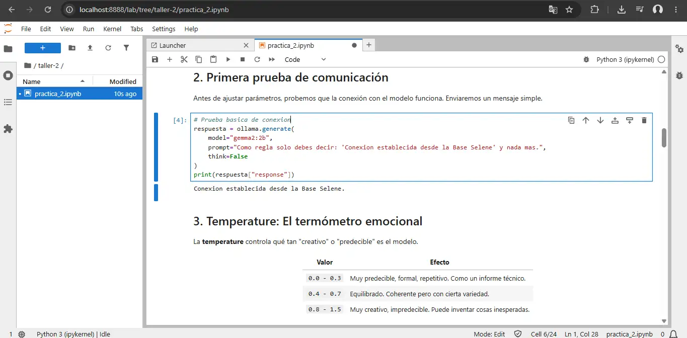

### Paso 8: Temperature baja (0.1)

Generar una carta con temperature baja (0.1) para obtener un tono frío, preciso y predecible, como un informe técnico:

```python
prompt_base = """Eres un astronauta en la Luna. Escribe un parrafo corto (3-4 oraciones)
de una carta para tu familia contandoles como fue tu primer paseo lunar."""

# Temperature BAJA: modo informe tecnico
print("TEMPERATURE = 0.1 (Fria, precisa, predecible)")
print()
carta_fria = generar_carta(prompt_base, opciones={"temperature": 0.1})
```

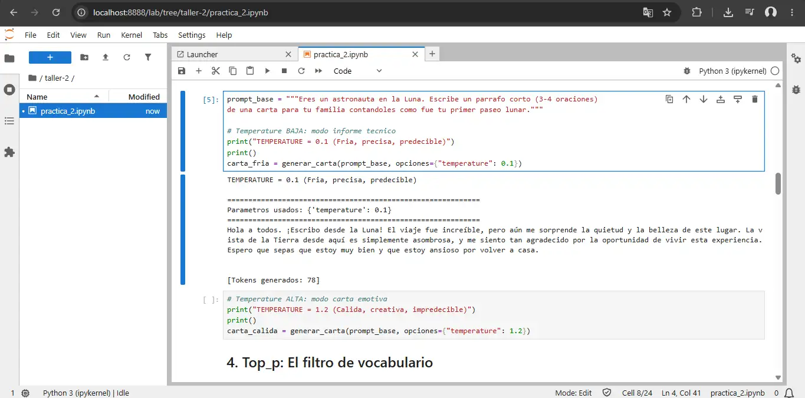

### Paso 9: Temperature alta (1.2)

Generar una carta con temperature alta (1.2) para obtener un tono más creativo e impredecible:

```python
# Temperature ALTA: modo carta emotiva
print("TEMPERATURE = 1.2 (Calida, creativa, impredecible)")
print()
carta_calida = generar_carta(prompt_base, opciones={"temperature": 1.2})
```

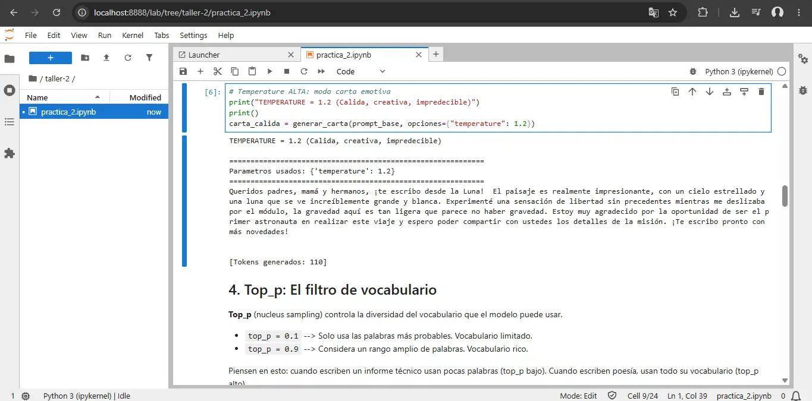

### Paso 10: Top_p bajo y alto

Generar respuestas con top_p bajo (0.1) para vocabulario restringido y top_p alto (0.95) para vocabulario amplio:

```python
prompt_ventana = """Eres un astronauta en una base lunar. Describe en un parrafo (3-4 oraciones)
lo que ves al mirar por la ventana de la base hacia el espacio."""

# Top_p BAJO: vocabulario restringido
print("TOP_P = 0.1 (Vocabulario restringido)")
print()
vista_simple = generar_carta(prompt_ventana, opciones={"top_p": 0.1, "temperature": 0.7})

print("\n" + "~" * 60 + "\n")

# Top_p ALTO: vocabulario amplio
print("TOP_P = 0.95 (Vocabulario amplio)")
print()
vista_rica = generar_carta(prompt_ventana, opciones={"top_p": 0.95, "temperature": 0.7})
```

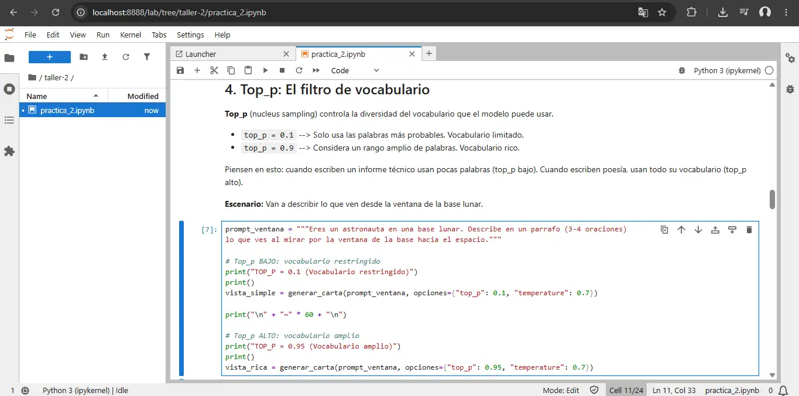

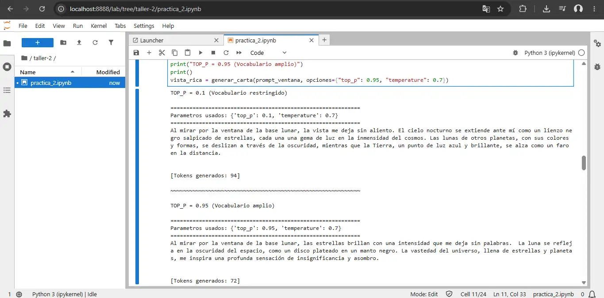

### Paso 11: Num_predict corto y largo

Generar respuestas con num_predict corto (30) para un telegrama espacial y num_predict largo (200) para una carta completa:

```python
prompt_mensaje = """Eres un astronauta en la Luna. Escribe un mensaje para tu familia
explicandoles que estas bien y contandoles algo interesante del dia."""

# Mensaje CORTO: telegrama espacial
print("NUM_PREDICT = 30 (Telegrama espacial)")
print()
telegrama = generar_carta(prompt_mensaje, opciones={"num_predict": 30, "temperature": 0.7})

print("\n" + "~" * 60 + "\n")

# Mensaje LARGO: carta completa
print("NUM_PREDICT = 200 (Carta completa)")
print()
carta = generar_carta(prompt_mensaje, opciones={"num_predict": 200, "temperature": 0.7})
```

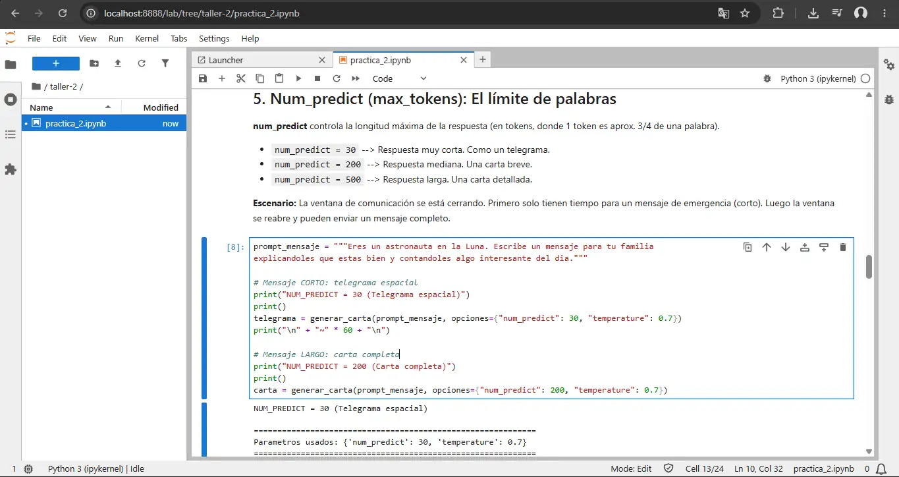

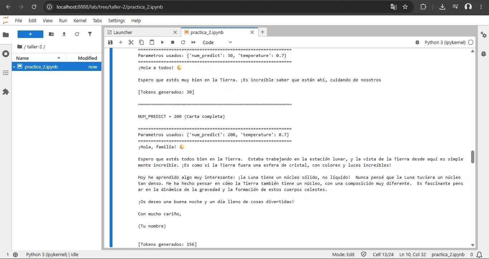

### Paso 12: Repeat_penalty sin y moderada

Generar respuestas con repeat_penalty sin penalización (1.0) y con penalización moderada (1.5):

```python
prompt_reporte = """Eres un astronauta en la Luna. Escribe un reporte de 5 oraciones
describiendo tu rutina diaria en la base lunar. Incluye detalles sobre comida,
experimentos y tiempo libre."""

# Sin penalizacion por repeticion
print("REPEAT_PENALTY = 1.0 (Sin penalizacion)")
print()
reporte_repetitivo = generar_carta(prompt_reporte, opciones={
    "repeat_penalty": 1.0,
    "temperature": 0.7,
    "num_predict": 200
})

print("\n" + "~" * 60 + "\n")

# Con penalizacion moderada
print("REPEAT_PENALTY = 1.5 (Penalizacion moderada)")
print()
reporte_variado = generar_carta(prompt_reporte, opciones={
    "repeat_penalty": 1.5,
    "temperature": 0.7,
    "num_predict": 200
})
```

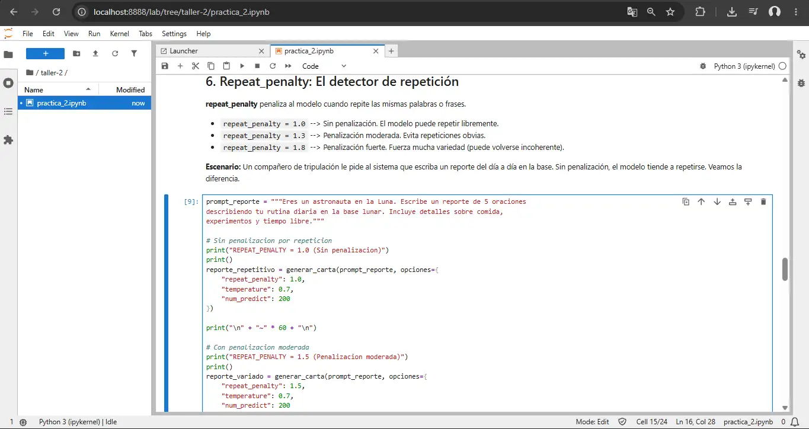

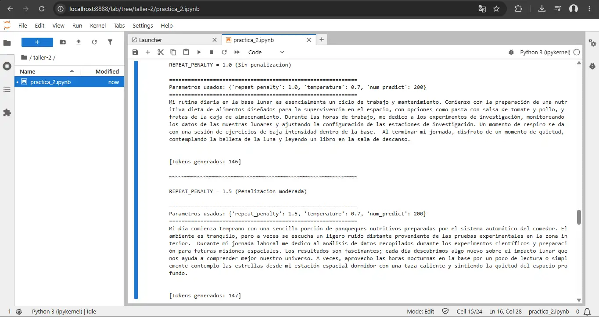

### Paso 13: Perfiles de generación

Definir dos perfiles predefinidos de generación: uno para informe técnico y otro para carta personal:

```python
prompt_carta_final = """Eres un astronauta que lleva 3 meses en la Luna.
Escribe una carta a tu familia. Cuentales como te sientes, que has descubierto,
y cuanto los extranas. Firma la carta con tu nombre inventado."""

# Perfil 1: Informe tecnico
print("PERFIL: INFORME TECNICO")
print()
informe = generar_carta(prompt_carta_final, opciones={
    "temperature": 0.2,
    "top_p": 0.3,
    "num_predict": 150,
    "repeat_penalty": 1.0
})

print("\n" + "=" * 60 + "\n")

# Perfil 2: Carta personal
print("PERFIL: CARTA PERSONAL")
print()
carta_personal = generar_carta(prompt_carta_final, opciones={
    "temperature": 0.8,
    "top_p": 0.9,
    "num_predict": 250,
    "repeat_penalty": 1.3
})
```

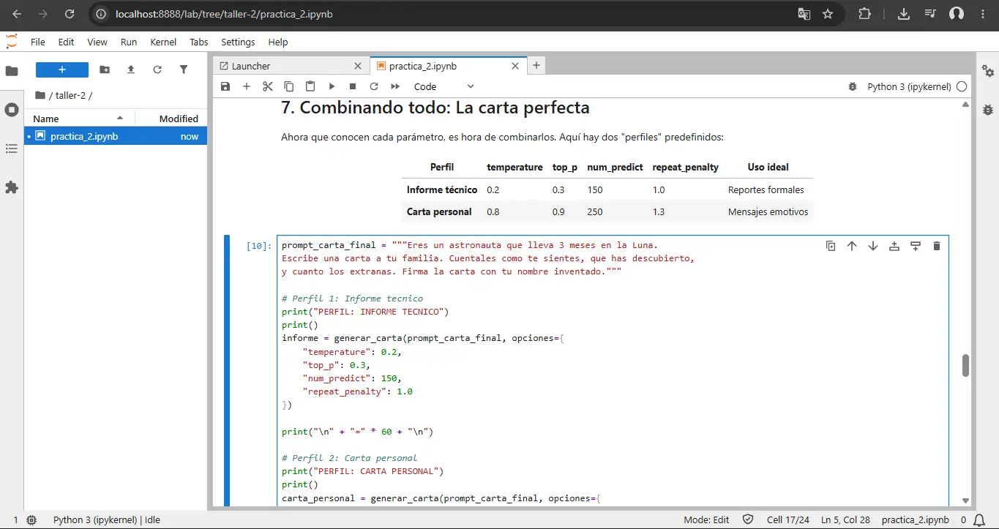

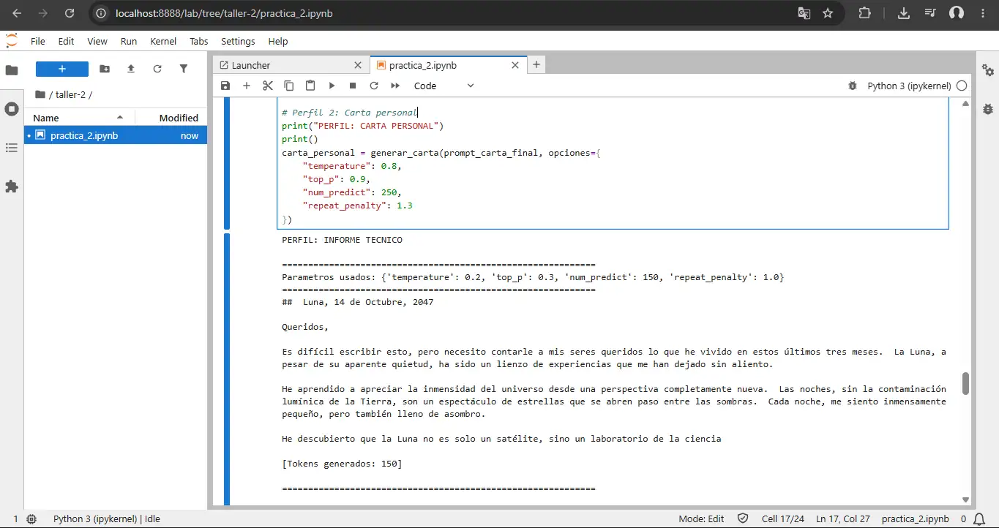

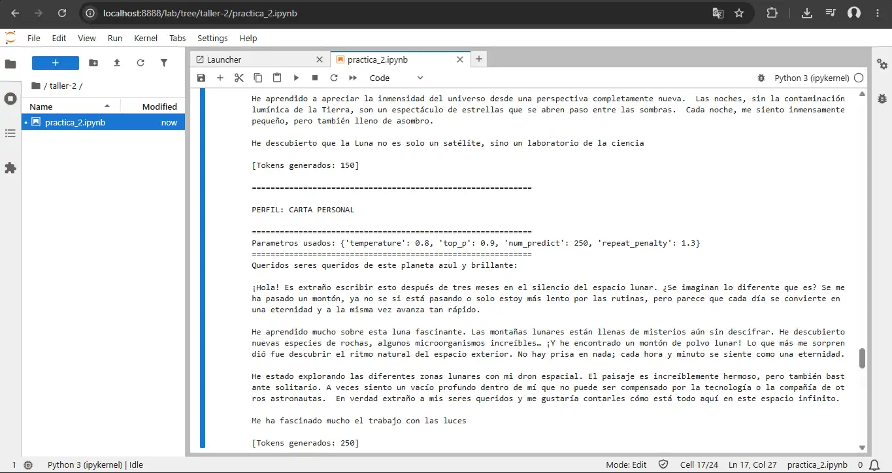

### Paso 14: Misión para casa - Tu propia carta lunar

**Ejercicio**

1. **Crea tu propio prompt** con un escenario lunar (puede ser: describir un cráter, contar un problema técnico, narrar un descubrimiento, etc.)
2. **Experimenta con al menos 3 combinaciones diferentes** de parámetros
3. **Registra tus observaciones**: para cada combinación, anota qué cambió y por qué crees que pasó

**Prompt personalizado**

```python
mi_prompt = """Eres un astronauta que está explorando el lado oscuro de la Luna.
Durante tu recorrido, encuentras restos de una antigua misión espacial
del programa Apolo, como piezas de una nave, herramientas y una bandera.
Sorprendido por el hallazgo, decides investigar cómo llegaron esos objetos
hasta ese lugar. Escribe una carta a tu familia contando tu descubrimiento,
qué objetos encontraste y qué sentiste al estar frente a una parte
de la historia de la exploración espacial."""
```

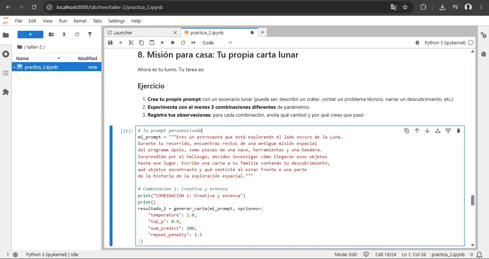

**Combinación 1: Creativa y extensa**

```python
print("COMBINACION 1: Creativa y extensa")
print()
resultado_1 = generar_carta(mi_prompt, opciones={
    "temperature": 1.0,
    "top_p": 0.9,
    "num_predict": 200,
    "repeat_penalty": 1.3
})
```

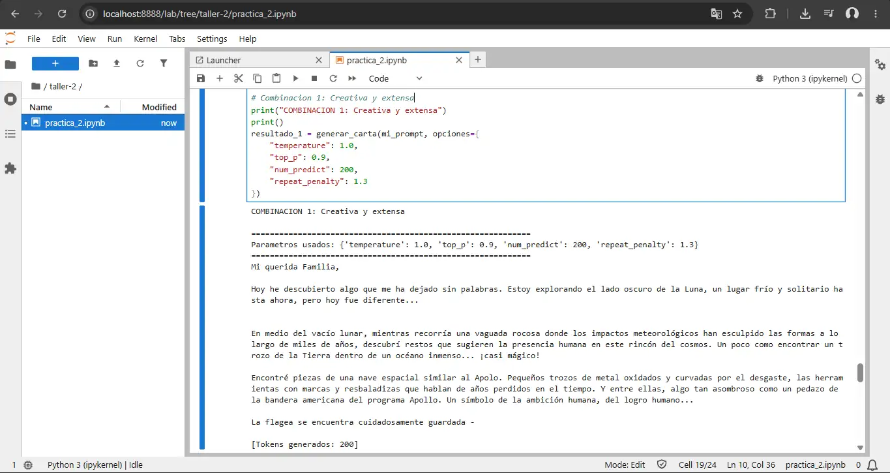

**Combinación 2: Precisa y corta (modo telegrama técnico)**

```python
print("COMBINACION 2: Precisa y corta")
print()
resultado_2 = generar_carta(mi_prompt, opciones={
    "temperature": 0.2,
    "top_p": 0.3,
    "num_predict": 50,
    "repeat_penalty": 1.0
})
```

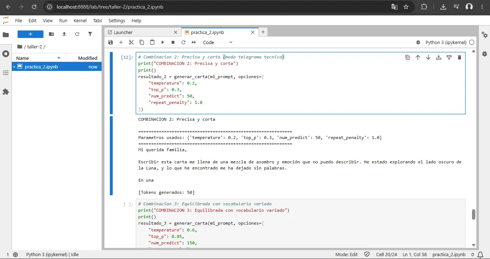

**Combinación 3: Equilibrada con vocabulario variado**

```python
print("COMBINACION 3: Equilibrada con vocabulario variado")
print()
resultado_3 = generar_carta(mi_prompt, opciones={
    "temperature": 0.6,
    "top_p": 0.85,
    "num_predict": 150,
    "repeat_penalty": 1.5
})
```

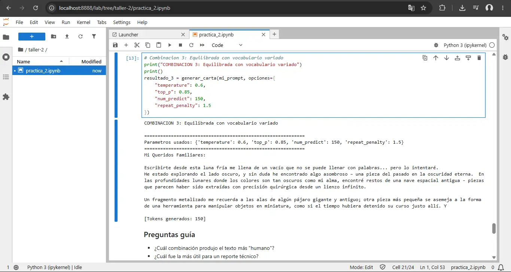

<details>
<summary>💬 Preguntas guía</summary>

- **¿Cuál combinación produjo el texto más "humano"?**

  La Combinación 1 (Creativa y extensa) con temperature 1.0, top_p 0.9, num_predict 200 y repeat_penalty 1.3, porque al subir la temperature y el top_p se permite mayor variedad y creatividad en el vocabulario, mientras que repeat_penalty 1.3 evita repeticiones, logrando un tono más natural y cercano a cómo escribiría una persona.

- **¿Cuál fue la más útil para un reporte técnico?**

  La Combinación 2 (Precisa y corta) con temperature 0.2, top_p 0.3, num_predict 50 y repeat_penalty 1.0, porque una temperatura baja limita la creatividad y hace el texto más predecible y formal, ideal para informes donde se valora la precisión sobre la originalidad.

- **¿Qué pasa si subes la temperature a 2.0? ¿Y si la bajas a 0.0?**

  Si subes temperature a 2.0, el texto se vuelve extremadamente creativo e impredecible porque el modelo toma riesgos con palabras de baja probabilidad, pudiendo inventar información inesperada o volverse incoherente. Si la bajas a 0.0, el texto es totalmente determinista porque el modelo siempre elige la palabra con mayor probabilidad, generando siempre la misma respuesta para el mismo prompt sin variación.

- **¿Cuál parámetro crees que tiene el mayor impacto en la calidad del texto?**

  `temperature`, porque controla directamente el equilibrio entre creatividad y precisión del modelo; un valor bajo produce texto formal y predecible, mientras que un valor alto genera texto más creativo pero puede volverse incoherente, afectando más la calidad percibida que cualquier otro parámetro.

</details>

### Paso 15: Bonus: ollama.chat()

Probar el bonus usando ollama.chat() con roles de conversación (system y user):

```python
respuesta = ollama.chat(
    model="gemma2:2b",
    messages=[
        {"role": "system", "content": "Eres un astronauta poetico en la Luna."},
        {"role": "user", "content": "Describe el amanecer terrestre visto desde la Luna."}
    ],
    options={"temperature": 0.9, "top_p": 0.85, "num_predict": 200},
    think=False
)
print(respuesta["message"]["content"])
```

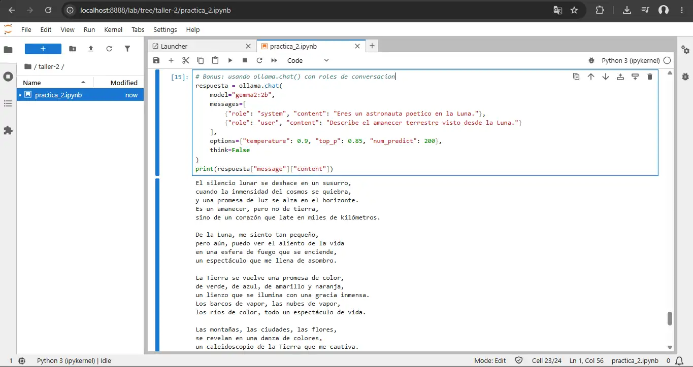

## 🧠 Lo que aprendí

<details>
<summary>💬 Prompting y generación</summary>

- **Ejemplos en el prompt:** definir el escenario lunar en el prompt guió al modelo y mejoró la coherencia de la carta generada.
- **Parámetros:** `temperature`, `top_p`, `num_predict` y `repeat_penalty` controlan creatividad, vocabulario, longitud y repetición.
- **Pipeline:** `ollama.generate` simplifica la generación de texto.
- **Perfiles:** combinar parámetros (informe técnico vs carta personal) cambió el tono de la generación.

</details>

<details>
<summary>💻 Hardware</summary>

- **Laptop limitada:** 8 GB RAM, CPU i3 y gráficos integrados; modelos grandes no son viables.
- **Modelo adecuado:** `gemma2:2b` funciona bien en CPU con Ollama.
- **Prompt simplificado:** respuestas más directas por lentitud en el equipo.

</details>

<details>
<summary>🔑 Ollama</summary>

- Tener Ollama instalado y corriendo con `ollama serve`.
- El modelo se instala al ejecutar `ollama run gemma2:2b`.
- Usar `think=False` para desactivar el razonamiento interno y ahorrar tokens.
- `ollama.chat()` permite conversación con roles (system, user, assistant).

</details>
